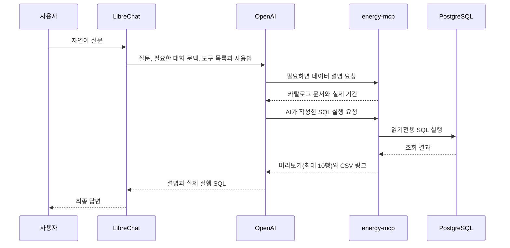

# LLM·MCP 데이터 처리와 투명성

자연어 질문이 어디로 전송되고 무엇이 저장되는지 설명합니다. 이 페이지에서 `MongoDB`는 원본 연구 데이터 저장소가 아니라 LibreChat과 MCP의 상태 저장소를 뜻합니다. 발전량·기상·수요 같은 원본 연구 데이터는 PostgreSQL `research` 스키마 또는 NAS에 있습니다.

## LibreChat에서 질문이 처리되는 경로

SQL은 채팅 AI가 직접 작성하고, 실행된 SQL을 답변에 함께 보여 주므로 사용자가 결과를 검증할 수 있습니다. 도구를 호출할 때마다 OpenAI가 다시 호출되고, 도구 결과(설명서, 조회 미리보기)는 최종 답변을 만들 수 있도록 OpenAI에 전달됩니다. 기상 예보는 NAS의 지역·요소·월별 파일 존재 여부를 먼저 확인하고 조회합니다.

## MongoDB는 두 가지 용도로 나뉩니다

| DB·컬렉션                               | 언제 사용            | 저장되는 내용                                           | 저장하지 않는 내용                   |
| ------------------------------------ | ---------------- | ------------------------------------------------- | ---------------------------- |
| LibreChat의 `LibreChat` DB            | LibreChat 이용 시   | 계정·대화·메시지·도구 호출과 응답·설정·사용량 관련 메타데이터               | PostgreSQL 원본 전체를 별도 복제한 테이블 |
| `energy_mcp.weather_collection_jobs` | 기상 예보 수집을 요청했을 때 | 작업 번호, 상태, 요청한 예보종·지역·요소·월, 생성·종료 시각, 결과 요약·오류 코드 | 기상청 계정·비밀번호, 조회 결과 행, CSV 내용 |

두 DB는 같은 MongoDB 서버를 사용하더라도 별도 DB와 별도 `readWrite` 계정을 사용합니다. LibreChat 계정은 `LibreChat` DB만, MCP 계정은 `energy_mcp` DB만 읽고 쓸 수 있도록 구성합니다. 일반 조회(SQL 실행)에는 MCP가 질문이나 SQL을 MongoDB에 저장하지 않습니다.

### 대화 기록과 대화 간 기억은 다릅니다

LibreChat은 같은 대화의 메시지 기록을 MongoDB에 저장하므로 앞에서 말한 조건을 이어갈 수 있습니다. 이것이 일반적인 채팅 문맥입니다. 반면 사용자의 취향이나 사실을 다른 대화에도 자동으로 넣는 **대화 간 장기 기억** 기능은 현재 설정에 활성화돼 있지 않습니다. 새 대화에서는 필요한 대상·기간·지표를 다시 말하세요.

LibreChat 대화 기록에는 사용자가 본 미리보기, SQL, 도구 호출 결과가 포함될 수 있습니다. 현재 프로젝트 설정에는 이 대화 기록을 자동 삭제하는 별도 TTL이 없으므로 사용자 또는 관리자가 삭제하기 전까지 남을 수 있습니다. 질문 원문도 이 대화 기록에 포함됩니다.

## 기상 수집 작업이 저장하는 상태

기상 예보 수집을 요청하면 작업 하나가 `running`으로 시작해 `completed`, `partial`, `unavailable`, `failed` 중 하나로 끝납니다. 이 상태가 작업 번호와 함께 MongoDB에 저장되고, 사용자는 작업 번호로 진행 상태를 다시 확인할 수 있습니다. 작업 기록은 생성 후 **7일**이 지나면 사용할 수 없고, `expires_at`에 걸린 MongoDB TTL 인덱스가 백그라운드에서 비동기로 삭제하므로 정확히 그 시각에 물리적으로 사라진다는 뜻은 아닙니다.

## 조회 결과와 CSV

* 채팅 미리보기는 최대 10행이며 LibreChat 대화 기록에 남을 수 있습니다.
* 조회 결과 행과 CSV 본문은 MCP의 MongoDB에 저장하지 않습니다.
* 큰 결과는 최대 300,000행의 CSV로 `/exports` 볼륨에 저장될 수 있습니다.
* CSV 파일명이 무작위여도 링크 자체에 별도 사용자 인증은 없습니다. 링크를 공유하지 마세요.
* 24시간이 지난 CSV는 **다음 CSV를 만들 때** 정리합니다. 정기 삭제 작업이 아니므로 후속 내보내기가 없으면 24시간보다 오래 남을 수 있습니다.

## OpenAI로 전송되는 정보

질문, 답변에 필요한 대화 문맥, MCP 도구 설명과 결과(데이터 설명서, 조회 미리보기)가 OpenAI API로 전송됩니다. 개인 DB 비밀번호, 서비스 OpenAI API 키, LibreChat JWT·암호화키를 프롬프트에 넣지 마세요.

OpenAI는 API 입력과 출력을 기본적으로 모델 학습에 사용하지 않는다고 안내합니다. 다만 기본 abuse-monitoring 로그에는 프롬프트와 응답 일부가 포함될 수 있고 최대 30일 보존될 수 있습니다. 이 저장소 설정만으로는 **Zero Data Retention** 적용 여부를 증명할 수 없으므로 abuse-monitoring에는 기본 정책을 전제로 사용해야 합니다.

* [OpenAI API 데이터 제어](https://developers.openai.com/api/docs/guides/your-data)
* [OpenAI 비즈니스 데이터 보호](https://openai.com/business-data/)
* [LibreChat의 MongoDB 사용 설명](https://www.librechat.ai/docs/user_guides/mongodb)
* [LibreChat의 선택형 장기 기억 설명](https://www.librechat.ai/docs/features/memory)

## 운영 설정과 자격증명

관리자는 LibreChat의 `librechat.env`와 MCP 서버의 Git 미추적 `llm/librechat/*.env`를 운영 환경에 맞게 관리합니다. 기상 수집 작업 저장소 접속용 `ENERGY_MCP_MONGO_URI`와 기상청 계정이 서버에만 있으며, 실제 값은 GitBook이나 추적되는 파일에 기록하지 않습니다. 사용자는 개인 OpenAI API 키나 개인 PostgreSQL 비밀번호를 LibreChat 프롬프트에 입력할 필요가 없습니다.

## 보존 범위 요약

| 위치               | 현재 확인된 보존 동작                                                 |
| ---------------- | ------------------------------------------------------------ |
| LibreChat 대화 기록  | 별도 프로젝트 TTL 없음. 사용자·관리자 삭제 전까지 남을 수 있음                       |
| 기상 수집 작업 기록      | 생성 후 7일. 이후 사용 불가, 물리 삭제는 MongoDB TTL의 비동기 처리                |
| CSV 내보내기         | 24시간 경과 파일을 다음 내보내기 시 정리                                     |
| PostgreSQL 감사 로그 | 별도 만료·로테이션 정책 없음                                             |
| OpenAI API       | 기본 abuse-monitoring 로그 최대 30일. 별도 데이터 제어 적용 여부는 저장소만으로 확인 불가 |

민감정보나 외부 제공이 금지된 분석은 자연어 서비스에 입력하지 말고 직접 SQL 경로를 사용하세요. 채팅 답변을 논문·보고서에 사용하기 전에는 표시된 실제 SQL과 원본 데이터를 다시 검증해야 합니다.
