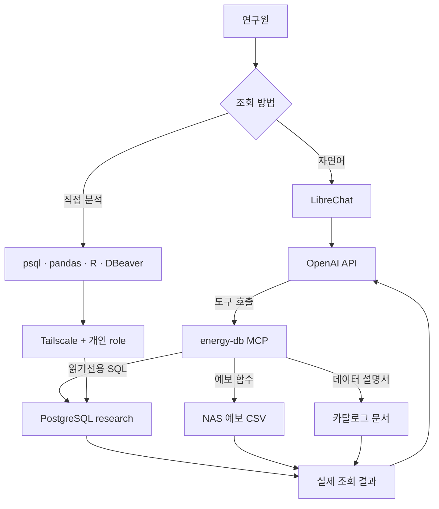

# 데이터 제공 구조

연구 데이터는 PostgreSQL `research` 스키마와 NAS에 보관합니다. 데이터 조회는 연구원이 개인 계정으로 직접 SQL을 실행하거나, 호스팅 LibreChat에서 자연어로 질문하면 AI가 SQL을 작성해 바로 조회하는 방식으로 제공합니다.

## 한눈에 보는 흐름

## 경로별 경계

| 경로               | 로그인·네트워크                                | PostgreSQL 신원     | 실행 방식                     |
| ---------------- | --------------------------------------- | ----------------- | ------------------------- |
| LibreChat 자연어 조회 | LibreChat 계정. 접속 주소에 따라 Tailscale 연결 필요 | 공용 읽기전용 `demo_ro` | AI가 작성한 SQL을 읽기전용으로 바로 실행 |
| 직접 SQL           | Tailscale 폐쇄망과 개인별 DB 계정                | 개인별 읽기전용 role     | 연구원이 SQL을 작성·실행           |

LibreChat에서는 질문에 필요한 대화 문맥과 조회 결과가 OpenAI API로 전송됩니다. 서버 측 MCP가 공용 `demo_ro`로 조회하므로 PostgreSQL 감사 기록에도 이 공용 계정이 남습니다. 직접 SQL 경로의 개인 role과 같은 인증·감사 경계가 아닙니다.

## LibreChat 조회 흐름

사용자가 MCP 도구 메뉴에서 `energy-db`를 켜고 질문하면 AI가 필요한 도구를 골라 호출하며, 사용한 SQL은 항상 답변에 함께 표시됩니다.

| 도구                           | 하는 일                                         |
| ---------------------------- | -------------------------------------------- |
| `describe_data`              | 데이터 카탈로그 문서와 DB에서 실측한 뷰별 기간을 가져옵니다           |
| `run_sql`                    | AI가 작성한 SQL을 실행해 미리보기(최대 10행)와 CSV 링크를 돌려줍니다 |
| `collect_forecast`           | NAS에 없는 기상 예보 월을 확인하고, 사용자가 요청하면 수집을 시작합니다   |
| `forecast_collection_status` | 기상 예보 수집 작업의 진행 상태를 알려 줍니다                   |

SQL을 실행하는 쪽에는 여러 겹의 제한이 있습니다. 공용 `demo_ro` 계정은 `research` 스키마를 읽기만 할 수 있고, 실행 세션은 읽기전용이며, 한 번에 SQL 한 문장만 실행합니다. 실행 시간 제한(기본 60초)을 넘으면 중단됩니다. 접속은 PgBouncer를 거쳐 동시 접속이 늘어도 DB 연결 수가 제한됩니다.

조회 행과 CSV 내용은 MongoDB에 저장하지 않습니다. CSV 보존은 24시간 정리 동작을 따릅니다. 상세 범위는 [LLM·MCP 데이터 처리와 투명성](../06-llm-transparency.md)을 참고하세요.

## 직접 SQL과 운영 데이터

직접 SQL은 Tailscale을 통해 개인별 읽기전용 계정으로 접속하는 별도 경로입니다. 호스팅 LibreChat에는 개인 DB 비밀번호를 입력하지 않습니다.

예보 시계열은 PostgreSQL 테이블에 적재되지 않고 NAS CSV를 조회 함수로 읽습니다. 지역 목록 CSV는 어떤 읍면동 이름이 준비되어 있는지 알려주며, 실제 시계열 CSV는 예보 값을 담습니다. 지역 목록에 있더라도 요청한 기간에 값이 없을 수 있습니다.

## 접속 정보

LibreChat 주소와 계정, Tailscale 접속 필요 여부는 관리자가 별도로 안내합니다. 공개 GitBook에는 실제 호스트 주소, 계정, 비밀번호, 초대 링크, 완성 DSN을 싣지 않습니다.
