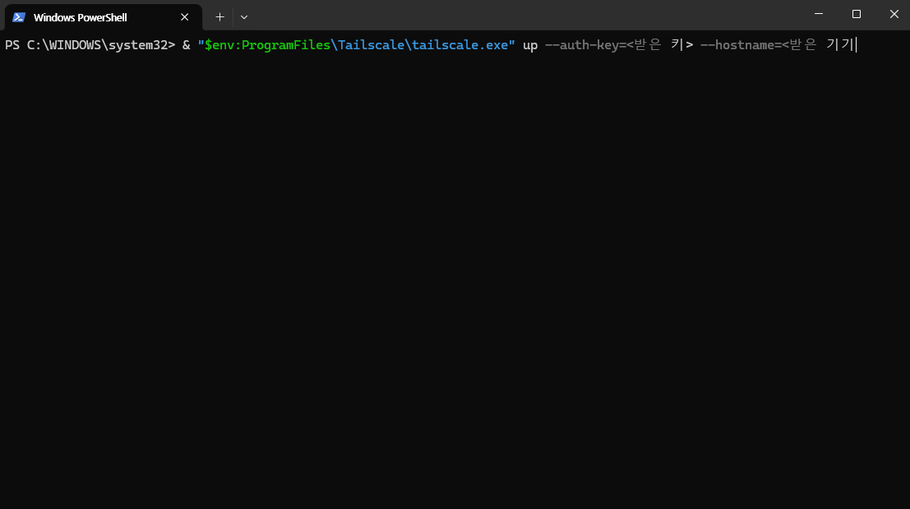

# 접속 준비하기

서비스는 닫힌 연구용 네트워크 안에 있습니다. 이 페이지는 내 PC를 그 네트워크에 연결하는 방법이며, PC마다 한 번만 하면 됩니다.


**Tailscale은 설치만 하면 됩니다. 로그인할 필요가 없습니다.**

Tailscale 계정은 만들지 마세요. 설치 후 나오는 **로그인 버튼도 누르지 마세요.** 구글·학교·회사 이메일로 가입하거나 로그인하지 마세요. 관리자가 보낸 명령어 한 줄로 연결됩니다.

**연결은 기기마다 따로 합니다.** 

접속 키는 기기 한 대에 하나씩이라, 다른 PC에서도 쓰려면 그 PC용 명령어를 따로 받아야 합니다.


## 준비물

* 연구에 쓸 PC (Windows 또는 Mac)
* 관리자에게 받은 **명령어 한 줄** (서비스 주소도 함께 받습니다)

## 1단계. 서약하고 신청하기

[이용·보안 서약 제출하기](https://docs.google.com/forms/d/e/1FAIpQLSeZA7YHBDeVmIvhqITWAlpWsLbyAF6cxX8o2uowQlq_mEG67Q/viewform)에서 **성명, 소속, 이메일, 전화번호**를 적고 동의 항목 8개에 모두 체크해 제출합니다. 이메일은 관리자가 명령어를 보내는 주소입니다. **나중에 LibreChat에 가입할 때도 같은 이메일을 쓰니 자주 확인하는 주소를 적으세요.** 서약 내용은 [이용조건 · 보안 서약](../05-terms.md)에 있습니다.

## 2단계. 명령어 받기

관리자가 서약을 확인하면 적어 둔 이메일로 **명령어 한 줄**과 서비스 주소를 보냅니다. 명령어 안에는 `tskey-auth-`로 시작하는 1회용 접속 키가 들어 있습니다. 한 번만 쓸 수 있고 보통 7일 안에 써야 하며, 다른 사람에게 전달하면 안 됩니다.

## 3단계. Tailscale 설치

[tailscale.com/download](https://tailscale.com/download)에서 운영체제에 맞는 프로그램을 **설치만** 합니다. 설치가 끝나면 **Log in(로그인) 버튼은 누르지 마세요.** 로그인하지 않아도 다음 단계의 명령어 하나로 연결됩니다.

## 4단계. 명령어 붙여 넣기

관리자가 보낸 명령어를 **한 줄 통째로 복사해서 붙여 넣기만** 하면 됩니다. 접속 키와 기기 이름이 이미 들어 있어서 직접 입력하거나 고칠 것이 없습니다.

### Windows

1. 시작 메뉴에서 **PowerShell**을 검색해 엽니다.
2. 받은 명령어를 붙여 넣고 Enter를 누릅니다.

아래는 붙여 넣은 모습의 예시입니다. 실제 명령어에는 접속 키와 기기 이름이 채워져 있습니다.



명령어는 `&`로 시작합니다. 맨 앞의 `&`까지 빠지지 않게 한 줄 전체를 복사하세요. 줄 앞이 `>>`로 바뀌며 계속 다음 줄로 넘어가면 `Ctrl+C`로 취소하고 다시 붙여 넣습니다.

### Mac

1. `⌘`+`Space`로 Spotlight를 열고 **터미널**을 검색해 엽니다.
2. 관리자가 보낸 **Mac용 명령어**를 붙여 넣고 Return을 누릅니다.

Mac용 명령어는 Windows와 앞부분이 다르고 모양은 아래와 같습니다. 설치한 Tailscale 앱 안에 들어 있는 프로그램을 직접 부르는 것이라 경로가 깁니다. 실제로는 접속 키와 기기 이름이 채워진 명령어를 받으니 그대로 붙여 넣으면 됩니다.

```bash
/Applications/Tailscale.app/Contents/MacOS/Tailscale login --auth-key=<받은 키> --hostname=<받은 기기 이름>
```

처음에는 macOS가 VPN 구성 추가를 허용할지 묻는 창을 띄울 수 있습니다. 이때는 허용을 누르세요.

## 5단계. 연결 확인

브라우저에서 관리자가 보낸 서비스 주소를 엽니다. 로그인 화면이 나오면 연결된 것입니다. 다음은 [첫 질문 해보기](first-query.md)입니다.

연결 상태를 명령어로 확인하려면 아래를 실행합니다. 목록에 관리자 서버가 보이면 연결된 것입니다.

```powershell
& "$env:ProgramFiles\Tailscale\tailscale.exe" status
```

```bash
/Applications/Tailscale.app/Contents/MacOS/Tailscale status
```

## 막혔을 때

| 증상 | 원인 | 해결 |
| --- | --- | --- |
| 명령어가 거부되거나 만료됐다고 나옴 | 7일이 지났거나 이미 한 번 쓴 명령어, 복사가 덜 됨 | 관리자에게 새 명령어를 요청합니다 |
| 줄 앞이 `>>`로 바뀌며 계속 넘어감 | `&`나 따옴표가 빠진 채 붙여 넣음 | `Ctrl+C`로 취소하고 한 줄 전체를 다시 붙여 넣습니다 |
| 이미 다른 Tailscale 계정으로 로그인된 PC | 예전에 Tailscale을 계정으로 써 본 PC | 위 5단계의 `status` 명령에서 `status`를 `logout`으로 바꿔 실행한 뒤 4단계를 다시 합니다 |
| 서비스 주소가 열리지 않음 | 연결이 끊김 | 5단계의 `status`로 확인하고 4단계를 다시 합니다 |
| PC를 바꾸거나 운영체제를 다시 설치함 | 새 기기로 취급됨 | 새 명령어를 요청합니다 |
| 다른 PC에서도 쓰고 싶음 | 기기마다 명령어가 따로 필요함 | 관리자에게 추가 명령어를 요청합니다 |

## 지켜 주세요

* 명령어에는 접속 키가 들어 있습니다. 쓰기 전에는 비밀번호와 같으니 채팅, 메일, 코드 저장소에 올리지 마세요.
* 명령어 하나는 PC 한 대용입니다.
* 과제가 끝나거나 연구에서 빠지면 관리자가 기기 등록을 삭제하고, 그 뒤에는 접속할 수 없습니다.
